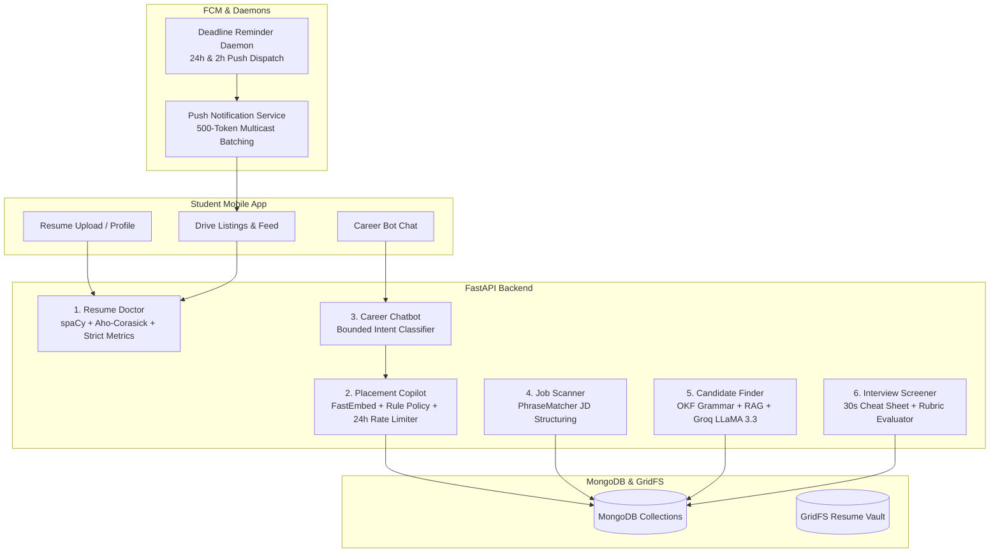

# TalentLOQ — Autonomous Campus Placement & AI Hiring Ecosystem

> **Connecting Students to Opportunity** | A Next-Generation Multi-Agent Campus Recruitment Ecosystem for Students, Corporate Recruiters, and University Placement Cells.

---

## 1. Overview

**TalentLOQ** is an enterprise-grade, cross-platform placement tracking and hiring intelligence platform engineered to automate and digitize the end-to-end campus recruitment lifecycle. Built to replace error-prone manual spreadsheets, physical paperwork, and fragmented communication channels, TalentLOQ provides a unified digital experience connecting **Students**, **Corporate Recruiters**, and **University Placement Officers**.

### Problem Solved
Traditional university hiring processes suffer from communication delays, lack of real-time application status visibility for students, high administrative sorting overhead for recruiters, and privacy risks when handling unencrypted academic records. TalentLOQ solves these challenges with:
- **Zero-Cost Deterministic ATS Doctor:** Sub-millisecond resume scoring and keyword gap analysis running 100% offline.
- **Autonomous Placement Copilot:** Autonomous background evaluation of new drives matching student preferences with automated rate-capped applications.
- **Recruiter AI Hybrid Agent:** Natural-language candidate search combining Optimal Keyword Filtering (OKF), RAG retrieval, and Groq LLaMA 3.3 streaming without hallucinations.
- **Multi-Channel Push Notifications:** Firebase Cloud Messaging (FCM) v1 multicast dispatch, in-app notification inbox, and a 24h / 2h automated deadline reminder daemon.
- **Candidate Validation & Screening Cheat Sheets:** 30-second recruiter screening cards with role-adaptive rubrics and custom interview questions.

---

## 2. Key Features

### 🎓 Student Portal
* **Live Placement Drives Feed:** Browse active corporate placement drives filtered by degree eligibility and minimum CGPA criteria.
* **Resume ATS Doctor (100% Offline):** Instant pre-apply ATS fit check (`0–100`) scoring keyword overlap, strong action verbs, quantifiable metrics (`%`, `+`, `$`, `₹`, `QPS`), and layout parseability with prioritized fix suggestions.
* **1-Tap Application Submission:** Apply instantly using verified academic records and stored PDF resumes.
* **Real-Time Application Tracker:** Live status tracking through Aptitude, Technical, and HR interview rounds with outcome indicators.
* **Notification Center & Deadline Alerts:** Multi-channel push alerts (FCM) and in-app inbox with automated 24h and 2h reminders before drive deadlines.
* **Native PDF Resume Viewer:** View and verify uploaded PDF resumes directly within the application.
* **Direct Recruiter Chat:** In-app conversation thread with live presence indicators and interview notices.

### 🏢 Recruiter & Placement Control Center
* **Candidate Validation Dashboard:** Live applicant verification across drives with multi-state filter chips (`All`, `Pending`, `Valid`, `Not Valid`), candidate CGPA, AI Match pills, and direct offer setup.
* **Recruiter AI Hybrid Agent:** Natural-language conversational copilot powered by Optimal Keyword Filtering (OKF) and Groq LLaMA 3.3 for sub-second candidate shortlisting.
* **30-Second AI Screening Cheat Sheet:** Candidate strengths, blindspots, custom interview icebreakers, and round-calibrated technical questions.
* **Drive Publishing Engine:** Create and publish company placement listings specifying min CGPA cutoffs, CTC packages, job roles, eligibility criteria, and brochure attachments.
* **Talent Comparator & DevOps Scorer:** Multi-candidate ranking evaluating Core Tech (40%), Cloud/DevOps taxonomy (30%), and Internships (30%).
* **Scheduled Campus Interviews Hub:** Schedule manager organizing candidate sessions with interview type, date/time, and status tracking.
* **Offer Setup & Dispatch:** Set up custom compensation, joining dates, and formal offer letters dispatched directly to student dashboards.

### 🤖 Multi-Agent Placement & Observability
* **Multi-Agent Architecture:** 6 specialized autonomous agents and ML engines handling parsing, matching, auto-apply, screening, and forecasting.
* **Token & Latency Observability:** Terminal banners displaying prompt, completion, and total tokens per LLM query alongside HTTP request latency metrics.
* **Immutable Audit Trail:** All agent decisions (auto-apply, alert, match) logged immutably to `agent_runs_collection`.

### 🔒 Security, Compliance & System Resilience
* **Field-Level Encryption (Fernet):** Encrypts sensitive academic data (CGPA, backlogs, contact info) at rest in MongoDB using Fernet (AES-128-CBC with HMAC-SHA256 authentication).
* **Multi-Factor Authentication (OTP 2FA):** Email-based OTP verification for sensitive login attempts and password resets.
* **Rate Limiting & Threat Prevention:** `slowapi` rate-limiting middleware guarding authentication endpoints against brute-force attacks.
* **Windows Hot-Reload Resilience:** Automated `WindowsProactorEventLoopPolicy` configuration and `_BaseSelectorEventLoop` teardown safeguards preventing asyncio crashes on Windows Python 3.12.

---

## 3. Tech Stack

| Category | Technology | Usage Details |
| :--- | :--- | :--- |
| **Frontend Framework** | **Flutter (Dart `^3.12.2`)** | Cross-platform mobile client app (Android & iOS) |
| **UI Design System** | **Material 3** | Dynamic Light & Dark mode, custom AppColors design system |
| **Networking & Pinning** | **Dio (`^5.11.1`)** | HTTP client with TLS Certificate Pinning & interceptors |
| **Push Notifications** | **Firebase Cloud Messaging (FCM)** | Remote push dispatch, foreground notifications, & deep-linking |
| **Local Storage** | **`flutter_secure_storage`** | Encrypted JWT token and device ID storage |
| **Backend Framework** | **Python 3.12 / FastAPI** | Asynchronous REST API server & SSE streaming (`app/main.py`) |
| **LLM Inference** | **Groq Cloud (LLaMA 3.3 70B & 3.1 8B)** | Ultra-low latency qualitative screening and conversational copilot |
| **Local NLP & ATS** | **spaCy `en_core_web_sm` + Aho-Corasick** | 100% offline, zero-cost keyword and skill taxonomy matching |
| **Vector Embeddings** | **FastEmbed (BAAI/bge-small-en-v1.5)** | Dense semantic similarity embeddings running via ONNX runtime |
| **Document OCR** | **RapidOCR / EasyOCR / PyMuPDF** | Two-tier document extraction: native PDF parsing + OCR fallback |
| **Database Engine** | **MongoDB (Async Motor Driver)** | NoSQL document database (`app/database.py`) |
| **File Storage** | **MongoDB GridFS** | Binary PDF resume & document bucket storage |
| **Security & Auth** | **PyJWT / Bcrypt / Fernet** | JWT bearer tokens, hashed passwords, and AES field-level encryption |
| **Testing** | **Pytest** | Comprehensive test suite for ATS, push notifications, and agent logic |

---

## 4. Multi-Agent System Architecture



---

## 5. Project Structure

```text
TalentLOQ/
├── assets/                        # App branding assets (splash, launcher icons)
├── backend/
│   ├── app/
│   │   ├── document_detection/    # Two-tier resume classification & OCR extraction
│   │   │   ├── classifier.py      # Structural document classification logic
│   │   │   └── extractor.py       # Native PDF (PyMuPDF) + OCR fallback (RapidOCR/EasyOCR)
│   │   ├── routers/               # FastAPI route controllers
│   │   │   ├── auth.py            # Auth, OTP, registration, & profile endpoints
│   │   │   ├── chat.py            # Recruiter-student chat & presence tracking
│   │   │   ├── documents.py       # Verification documents & audit trail
│   │   │   ├── drives_recruiter.py# Recruiter drive management & AI screening
│   │   │   ├── drives_student.py  # Student drive browsing & ATS fit check
│   │   │   ├── files.py           # Secure GridFS file streaming & token downloads
│   │   │   ├── interviews.py      # Campus interview scheduling
│   │   │   ├── notifications.py   # FCM token registration & in-app inbox
│   │   │   └── recruiter.py       # Candidate validation, applicant queries, & stats
│   │   ├── services/              # Autonomous agents & intelligent engines
│   │   │   ├── ai_bot_assistant.py         # Career Chatbot & natural language parser
│   │   │   ├── autonomous_placement_agent.py# Placement Copilot with 24h rate limit
│   │   │   ├── deadline_reminder_service.py # Background 24h & 2h reminder daemon
│   │   │   ├── firebase_manager.py          # Firebase Admin SDK v1 singleton
│   │   │   ├── groq_matcher.py             # Interview Screener & 30s cheat sheet
│   │   │   ├── push_notification_service.py # FCM multicast & in-app inbox engine
│   │   │   ├── recruiter_ai_agent.py        # Candidate Finder (OKF + RAG + LLaMA 3.3)
│   │   │   ├── resume_ats_doctor.py         # 100% offline Resume ATS Doctor
│   │   │   ├── skill_matcher.py            # spaCy PhraseMatcher & canonical taxonomy
│   │   │   └── talent_comparator.py        # 40/30/30 multi-candidate ranking engine
│   │   ├── config.py              # Application settings & environment configuration
│   │   ├── database.py            # MongoDB Motor client & collection indexes
│   │   ├── dependencies.py        # Role-Based Access Control (RBAC) dependencies
│   │   ├── eligibility.py         # Campus placement policy qualification engine
│   │   ├── encryption.py          # Fernet field-level encryption
│   │   └── main.py                # FastAPI entry point, lifespan, & middlewares
│   ├── tests/                     # Automated test suites
│   ├── Dockerfile                 # Production backend container image
│   └── requirements.txt           # Python dependencies
├── lib/                           # Flutter Mobile Application
│   ├── navigation/                # Main Navigation Wrapper & Role-Based Router
│   ├── network/                   # Dio ApiClient & TLS Cert Pinning configuration
│   ├── screens/                   # UI Screens (Auth, Jobs, Profile, Recruiter, Notifications)
│   │   ├── notifications/         # Notification Inbox & Preferences screens
│   │   ├── recruiter/             # Recruiter Dashboard, Candidate Detail, AI Chat
│   │   └── jobs/                  # Job details with live ATS check meter
│   ├── services/                  # Dart service clients (NotificationService, AuthService, etc.)
│   ├── theme/                     # AppColors & AppTheme Material 3 styles
│   └── main.dart                  # Flutter entry point with global navigatorKey
└── README.md                      # Project documentation
```

---

## 6. Installation & Setup

### 1. Clone Repository
```bash
git clone https://github.com/yash0622/TalentLOQ.git
cd TalentLOQ
```

### 2. Backend Setup
```bash
cd backend
python -m venv venv

# Windows (PowerShell):
.\venv\Scripts\Activate.ps1
# Linux/macOS:
source venv/bin/activate

pip install -r requirements.txt
```

### 3. Frontend Setup
```bash
cd ..
flutter pub get
```

---

## 7. Environment Configuration

Create a `.env` file inside `backend/` based on the following template:

```env
# Application Mode & Host
APP_ENV=development
PORT=8000

# MongoDB Configuration
MONGODB_URL=mongodb://localhost:27017
DATABASE_NAME=talentloq_db

# Security & Encryption Keys
JWT_SECRET_KEY=your_secure_jwt_secret_key_here
JWT_ALGORITHM=HS256
ACCESS_TOKEN_EXPIRE_MINUTES=30
REFRESH_TOKEN_EXPIRE_DAYS=7
ENCRYPTION_KEY=your_32_byte_base64_aes_encryption_key_here

# Groq Cloud API Key
GROQ_API_KEY=your_groq_api_key_here

# Firebase Cloud Messaging Credentials
# Path to service account JSON file OR raw JSON string:
FIREBASE_CREDENTIALS=path/to/serviceAccountKey.json

# CORS Configuration
ALLOWED_ORIGINS=http://localhost:3000,http://localhost:8000,http://127.0.0.1:8000
```

---

## 8. Running the Application

### Start Backend API Server
```bash
cd backend
uvicorn app.main:app --reload --host 0.0.0.0 --port 8000
```
* **Interactive Swagger UI:** [http://localhost:8000/docs](http://localhost:8000/docs)
* **Alternative ReDoc:** [http://localhost:8000/redoc](http://localhost:8000/redoc)

### Start Flutter Client
```bash
flutter run
```

---

## 9. Key API Endpoints

| Method | Endpoint | Description | Auth Required |
| :--- | :--- | :--- | :--- |
| `POST` | `/auth/register` | Register student or recruiter account | None |
| `POST` | `/auth/login` | Authenticate user and receive access/refresh tokens | None |
| `POST` | `/auth/otp/send` | Request email OTP for 2FA verification | None |
| `POST` | `/auth/otp/verify` | Verify email OTP code | None |
| `GET` | `/drives/{id}/ats-check` | 100% offline ATS score and keyword gap analysis | Student Bearer |
| `POST` | `/notifications/device-token` | Register or refresh FCM device token | Bearer Token |
| `DELETE`| `/notifications/device-token` | Revoke FCM device token on logout | Bearer Token |
| `GET` | `/notifications` | Cursor-paginated in-app notification inbox | Bearer Token |
| `POST` | `/notifications/read-all` | Mark all inbox notifications as read | Bearer Token |
| `GET` | `/notifications/preferences` | Get user notification category toggles | Bearer Token |
| `GET` | `/recruiter/drives` | List published placement drives | Optional Bearer |
| `POST` | `/recruiter/drives` | Create a new company placement drive | Recruiter Bearer |
| `GET` | `/recruiter/drives/{id}/applicants/{sid}/ai-insight` | 30s candidate screening cheat sheet & interview questions | Recruiter Bearer |
| `POST` | `/recruiter/applications/{id}/validate` | Update candidate validation status (`valid`/`not_valid`) | Recruiter Bearer |

---

## 10. Automated Testing

TalentLOQ maintains automated unit and integration tests across all services:

```bash
cd backend
python -m pytest tests/
```

Test coverage includes:
- `tests/test_resume_ats_doctor.py`: Deterministic ATS scoring, keyword overlap, bullet start verbs, layout health, and currency/metric parsing.
- `tests/test_notifications.py`: In-app notification creation and read states.
- `tests/test_push_notifications.py`: FCM multicast batching, token deduplication, dead-token pruning, preference filtering, and cursor pagination.
- `tests/test_recruiter_ai_agent.py`: OKF grammar parsing, RAG student retrieval, SSE streaming, and zero-hallucination guarantees.

---

## 11. License & Acknowledgements

* **Flutter Framework** for cross-platform UI development.
* **FastAPI** for high-performance Python backend routing.
* **MongoDB & Motor** for async NoSQL document and GridFS storage.
* **Groq Cloud** for ultra-fast LLaMA 3.3 LLM inference.
* **Firebase Cloud Messaging** for cross-platform push notifications.